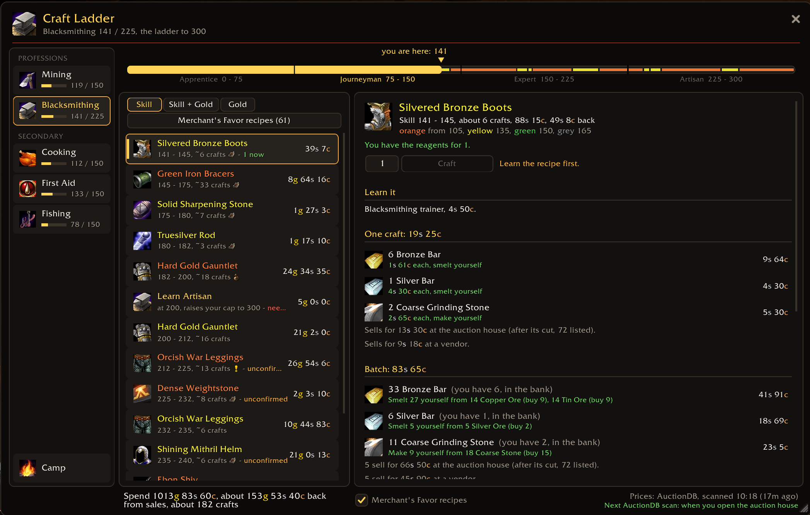
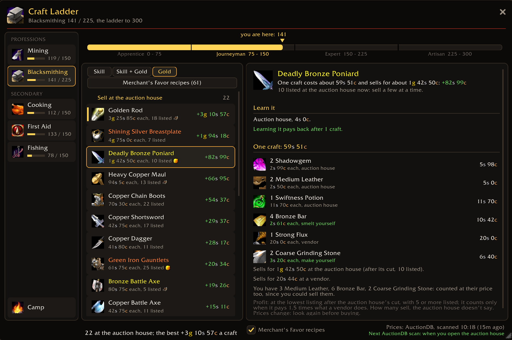
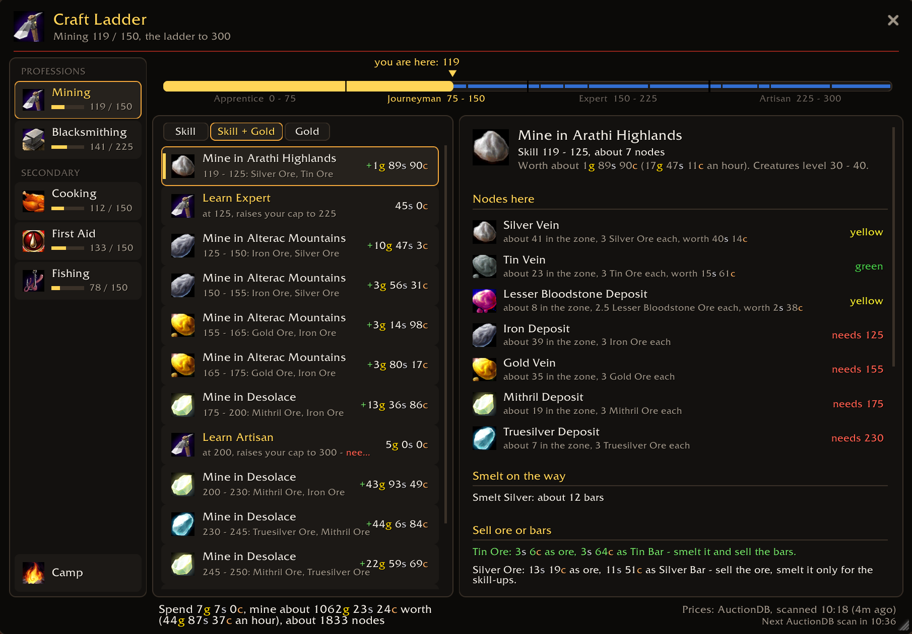
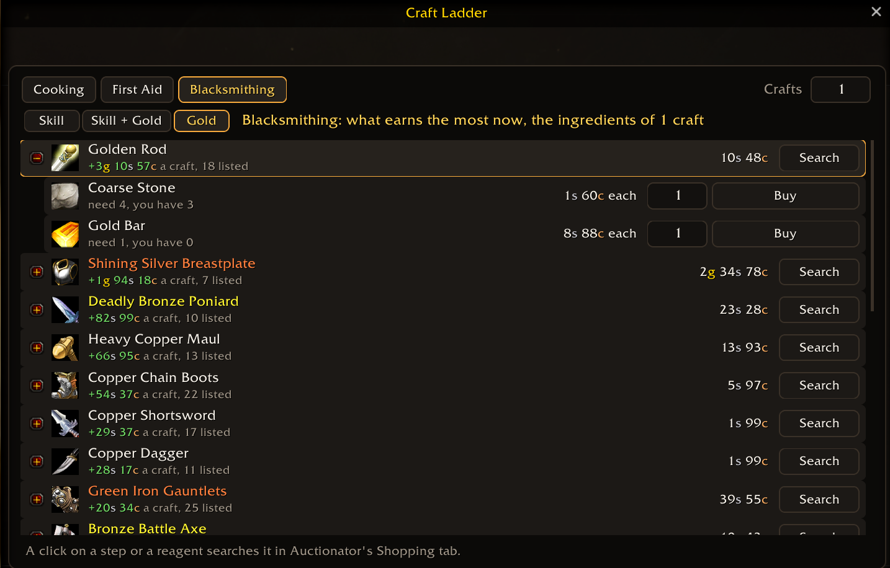
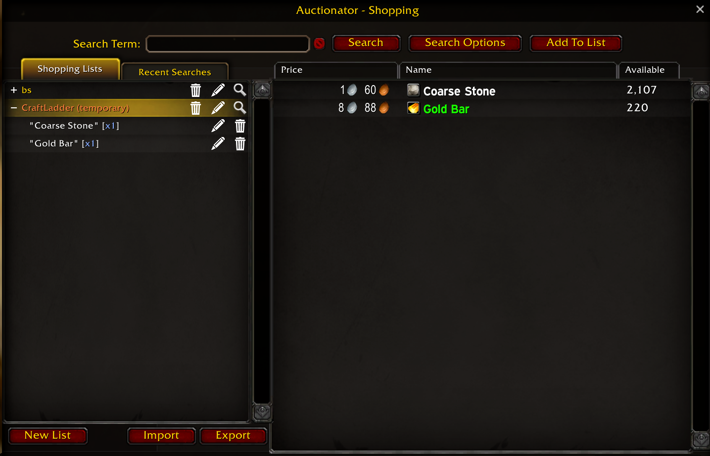
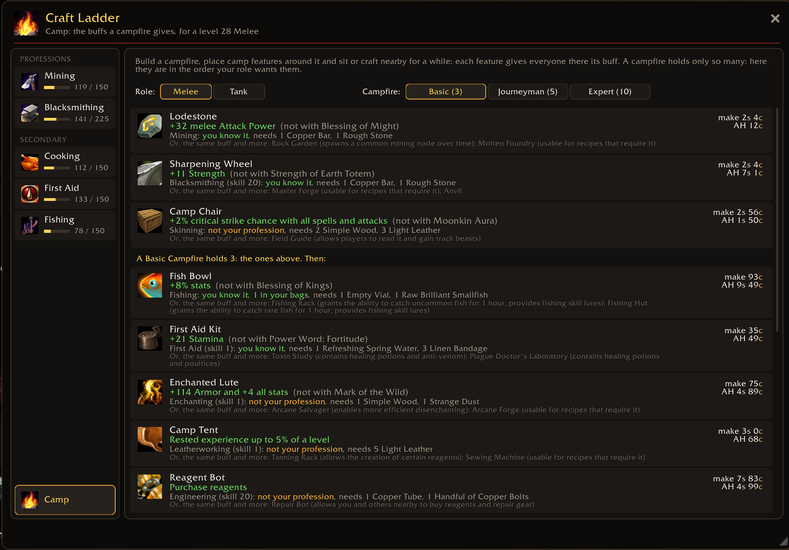
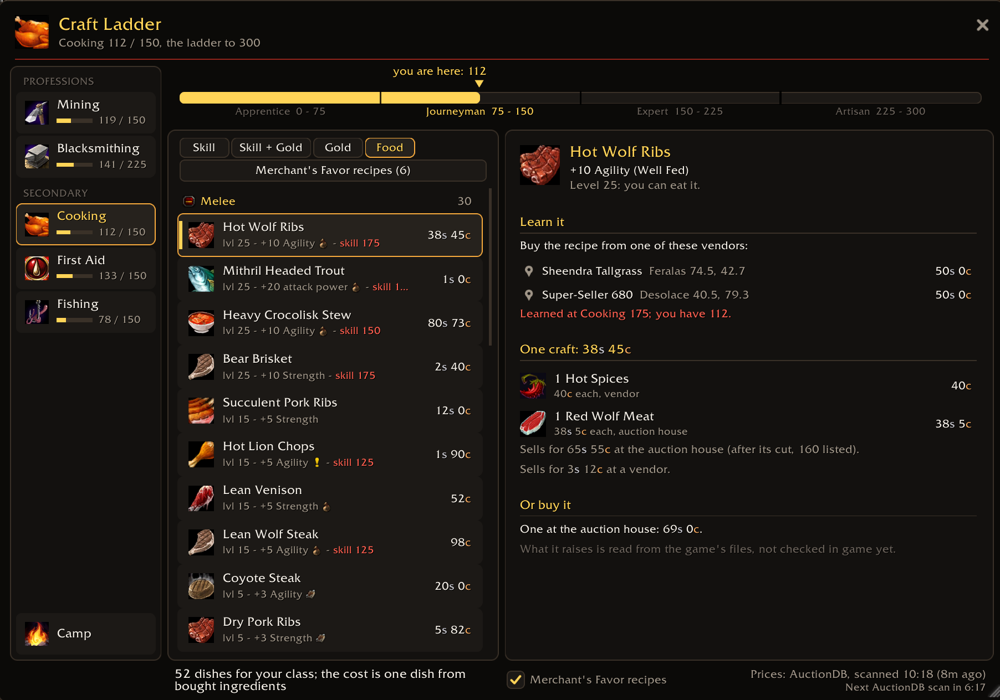

# Craft Ladder

Craft Ladder is a smart **profession leveling and crafting optimization addon** for **World of Warcraft: Forever**. It helps you find cost-efficient routes from skill 1 to 300 using auction house prices, vendor costs, and materials already in your bags.

Whether you're leveling **Engineering, Alchemy, Blacksmithing, Tailoring, Cooking**, or gathering professions, Craft Ladder creates a step-by-step plan showing what to craft, how many items you need, where to learn each recipe, and how much it will cost. It also helps you discover profitable crafting opportunities and gathering zones.

**[Download Craft Ladder on CurseForge](https://www.curseforge.com/wow/addons/craft-ladder)**



## Professions

- **Crafting:** Alchemy, Blacksmithing, Enchanting, Engineering, Leatherworking, Tailoring, Cooking, First Aid, Poisons
- **Gathering:** Mining, Herbalism, Skinning, Fishing, Lockpicking

## Modes

- **Vendor sales** (gathering: **Skill**): level up for the least gold you're sure to spend. What you make is counted
  as sold to vendors only: no auctions to post or wait for (gathering: the fastest points).
- **AH sales**: level up counting what the auction house pays for what you make too: cheaper than Vendor sales if it
  sells (gathering: where an hour earns the most on the way).
- **Profit**: no ladder, just what you can make now that earns the most per craft (for gathering: the zones where an
  hour earns the most at your skill).
- **Food** (Cooking): the dishes worth eating for your class, grouped by role, by what their Well Fed raises, each in
  its skill-up colour.

## What each step tells you

- The recipe, the skill range and about how many crafts it takes, coloured as the game colours it.
- Where to learn it: trainer, vendor, quest, auction house or a recipe already in your bags, with the NPC and its
  place.
- Every reagent: bought at a vendor, at the auction house, or made by you, and what the whole step costs (red, with a
  minus) or earns back (green, with a plus).
- What you already have counts: bags and, with Bagnon, the bank. A step you can make from your bags goes first, and
  each step says how many of its crafts what you have covers ("12 ready"; vendor reagents aside).
- The recipes you know are read from your profession window; a recipe you just learned counts at once.

For gathering: the zones to level in, the nodes, herbs, creatures or fishing pools that still give a point, and the
gold an hour each zone earns.

## Also

- **Auction house tab**: the ladder as a shopping list, a row per step with its reagents. With Auctionator, its
  Search button opens Auctionator's Shopping tab with exactly what to buy.
- **Merchant's Favor recipes**: the supply camps' quartermaster recipes, with their favor prices and what one craft
  takes (your bars and ore counted first), and a Favor mode in the auction house tab to buy it. They can join the
  ladder too.
- **Camp**: what each camp feature gives around a campfire at your level, in the order your role wants them, and how
  to get it.
- **Specialization** (Blacksmithing, Engineering, Leatherworking): the steps to each specialization, with the quest
  givers on the map, the quests done or in your log, what they ask for against your bags and bank, the recipes you
  know or still need, and what's left to make or buy.
- The range to level: From and To over the ladder (or a rank's name under the skill bar), Reset for your skill
  to 300.
- A minimap button and the addon compartment; the window remembers its size, scale and place.

## Screenshots

Profit: what earns the most per craft now.



Mining in AH sales: the zones to level in, the nodes there and what they're worth.



The auction house tab, and what its Search button opens in Auctionator.





Camp: the camp features in the order your role wants them.



Cooking's Food mode: the dishes worth eating for your class.



## Install

Install it from [CurseForge](https://www.curseforge.com/wow/addons/craft-ladder) (or its app), or unzip
`CraftLadder` into your WoW Forever client's `Interface\AddOns` folder and restart the game.

For auction house prices, install **AuctionDB** (the main source) or **Auctionator** (used when AuctionDB has no
price) and scan the auction house. Craft Ladder needs neither, but without them it prices by vendors only: reagents
from the auction house say "no price" and Gold is empty.

## Commands

| Command | What it does |
| --- | --- |
| `/craft` | Open or close the window |
| `/craft <profession>` | Open it on that profession, e.g. `/craft mining` |
| `/craft chat` | Print the ladder in chat |
| `/craft minimap` | Hide or show the minimap button |
| `/craft status` | What's loaded and the last calculation |

`/chef` works too.

## Good to know

- Built on WoW Forever's own client data. Where Forever doesn't say yet (a trainer's skill, a quest's reward), the
  value is Classic's or estimated, and the step is marked **unconfirmed** with a line saying why.
- What trainers and vendors show you in game is recorded and corrects the data as you play.
- The window calculates only what it shows, and only while it's open.

## Bugs and ideas

Open an issue: https://github.com/saintmodx/craft-ladder/issues

## For developers

- `CraftLadder/`: the addon (load order in `CraftLadder.toc`). `CraftLadder/Data/*.lua` is generated: don't edit it
  by hand.
- `tools/`: the Python 3 builders that make `Data/*.lua` (standard library only), e.g.
  `python tools/build_crafting.py blacksmithing`. They download the Forever client's tables (wago.tools), CMaNGOS
  classic-db and AllTheThings into `tools/cache/`, and read QuestieDB and GatherMate2_Data from an installed game:
  its path is set at the top of `tools/questiedb.py`, `tools/build_mining.py` and `tools/build_fishing.py`.
- `tests/`: offline tests with LuaJIT, the game's API mocked in `tests/wowmock.lua`:

  ```
  luajit tests/check_data.lua
  luajit tests/test_ladder.lua yungzug 300
  luajit tests/test_game.lua
  ```

## License and credits

Craft Ladder is free software under the GNU General Public License v3.0 (`CraftLadder/LICENSE`). Its data is built
from WoW Forever's client tables (via wago.tools), CMaNGOS classic-db, Questie and QuestieDB, AllTheThings (MIT) and
GatherMate2_Data; prices in game come from AuctionDB and Auctionator. Full credits: `CraftLadder/CREDITS.txt`.
